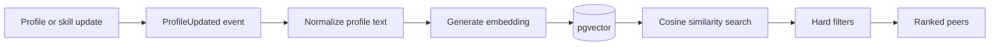

# AI Design

## Features

| Feature | Input | Output | Guardrails |
|---|---|---|---|
| Semantic matching | Profile, skills, goals | Ranked peers + explanation | Hard filters, explainable score |
| SkillBot | Message / code context | Explanation or debugging help | Context cap, secret redaction, rate limit |
| Roadmap | Current skills + target role | Ordered learning DAG | Strict JSON schema validation |
| Repository analysis (post-MVP) | Repo metadata/code | Analysis report | Sandboxed execution |

## Matching pipeline



## Score (explainable v1)

```text
score = 0.50 * semanticCompatibility
      + 0.25 * complementarySkillScore
      + 0.15 * goalAlignment
      + 0.10 * activityScore
```

| Component | Definition |
|---|---|
| semanticCompatibility | Cosine similarity between embeddings |
| complementarySkillScore | Overlap of A's `teach` with B's `learn` and vice versa |
| goalAlignment | Similarity of stated goals |
| activityScore | Recency-weighted activity |

Every match response returns the component breakdown so results are explainable. Weights are configuration, not constants.

**Hard filters:** self, already connected, blocked, inactive accounts.

**Fallback:** if embeddings are unavailable, rank by `complementarySkillScore` alone.

**Evaluation:** keep a fixed set of test profiles with expected ordering and run it in CI to catch regressions. Later track connection acceptance rate and match click-through. Do not publish an accuracy figure until it is measured on this set.

## Provider abstraction

```text
LLMProvider (interface)
   ├── GeminiProvider
   └── FutureProvider
```

Model-specific code stays behind this interface. Embedding model name and dimension are stored with each vector so models can be swapped and re-indexed.

## SkillBot flow
React → WebSocket → Chat Service → AI Service → Gemini → validated response → chat.

## Guardrails (all AI calls)
- Cap context size and prompt length
- Redact secrets and API keys before sending
- Send minimum personal data
- Per-user rate limits and request timeouts
- Validate model output against a schema before use
- Log metadata (latency, token counts, status), never content

## Roadmap DAG

```text
Node { id, title, description, order, status, prerequisites[] }
```

The service rejects outputs with cycles, unknown prerequisites, or missing fields, retrying once before returning `AI_UNAVAILABLE`.
