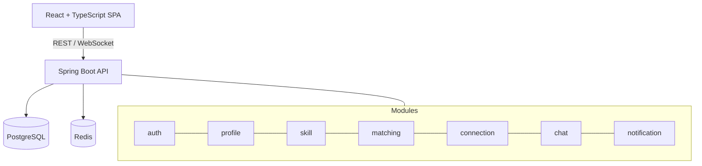
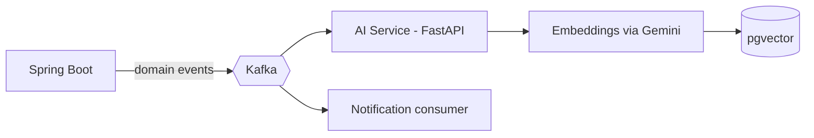
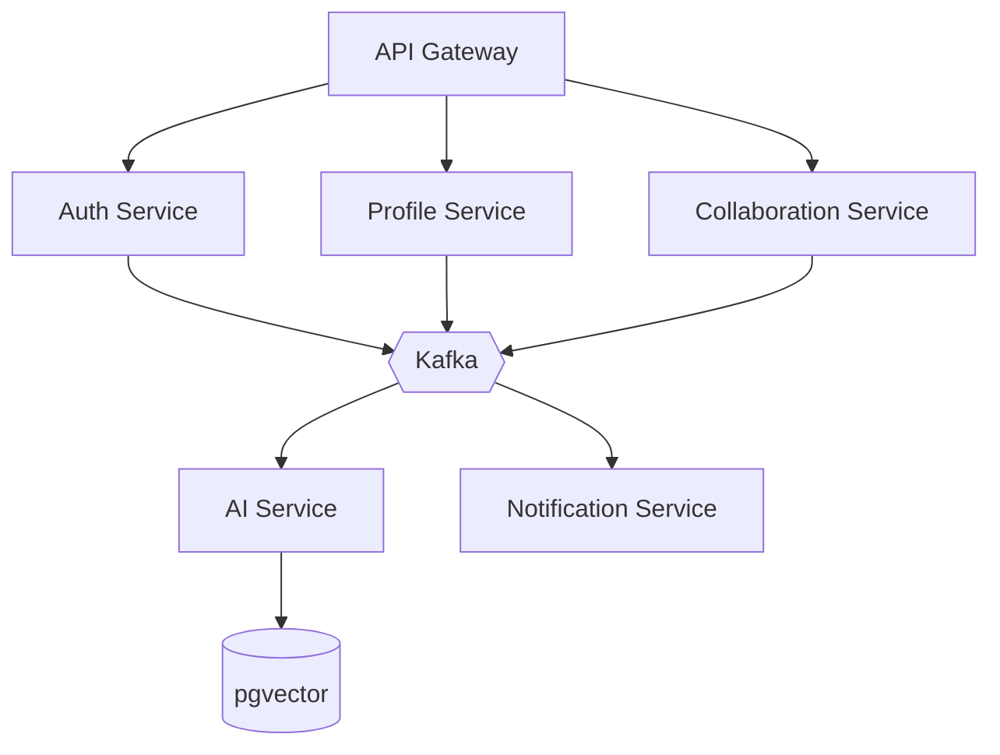
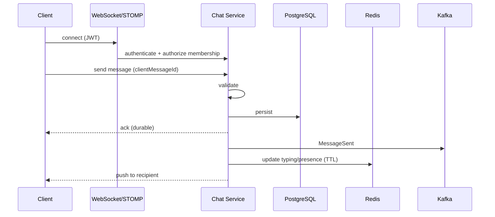

# Architecture

## 1. Principle
Start with a **modular Spring Boot monolith**. Extract a service only when there is a real domain boundary, a distinct scaling need, or an independent deployment need. Boundaries follow **business ownership**, not technical layers.

## 2. Stage A: Modular monolith (foundation)



## 3. Stage B: Event-driven extension



## 4. Stage C: Selective microservices (only if justified)



## 5. Module ownership

| Module | Owns | Publishes events |
|---|---|---|
| auth | users, credentials, refresh tokens | UserRegistered, UserDeleted |
| profile | profile, projects, user skills | ProfileUpdated, ProjectUpdated |
| skill | skill catalog | none |
| matching | scores, match queries | none |
| connection | connection requests | ConnectionCreated |
| chat | conversations, messages, presence | MessageSent |
| notification | notifications | none |
| common | errors, config, security utils | none |

Modules talk through service interfaces or events, never through each other's repositories.

## 6. Layering inside each module

```text
controller  →  service  →  repository  →  entity
     ↑ DTOs (validated)       ↑ never returned from APIs
```

## 7. Chat message flow



## 8. Failure behaviour

| Dependency down | Expected behaviour |
|---|---|
| Redis | Chat still works; presence/typing degrade; cache misses go to DB |
| Kafka | Core API keeps working; events retried via outbox (see ADR-0004) |
| AI service / Gemini | Matching falls back to rule-based score; SkillBot returns a friendly error |
| PostgreSQL | Service unhealthy; readiness probe fails |
