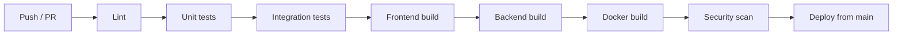

# Deployment & Operations

## Environments

| Env | Purpose | Notes |
|---|---|---|
| local | Development | Docker for dependencies |
| staging | Production-like validation and demos | Seeded test data only |
| production | Public deployment | Separate credentials, never used locally |

## Local commands

```bash
docker compose -f infra/docker-compose.yml up -d postgres redis kafka
cd backend && ./mvnw spring-boot:run
cd frontend && npm install && npm run dev
cd ai-service && python -m uvicorn app.main:app --reload
```

## CI/CD (GitLab CI)



Deploy only from the protected `main` branch. Tag images with the commit SHA.

## Observability

**Structured logs** with `timestamp, level, service, requestId, correlationId, userId (when appropriate), event, duration`.

| Metric | Why |
|---|---|
| HTTP latency and error rate | User experience |
| DB pool usage | Saturation |
| Redis latency | Cache/presence health |
| Kafka consumer lag | Async backlog |
| WebSocket connections | Capacity |
| AI latency and failure rate | Dependency health |
| Match generation latency | Core feature speed |

**Health:** `/actuator/health` with liveness and readiness groups.

## Runbook (starter)

| Symptom | First checks |
|---|---|
| Chat messages delayed | Kafka consumer lag, Redis latency, DB pool |
| Matches empty or stale | AI service health, `ai.events` DLQ, embedding backlog |
| 429s spiking | Rate-limit config, possible abuse |
| Login failures | JWT secret/config drift, clock skew |
