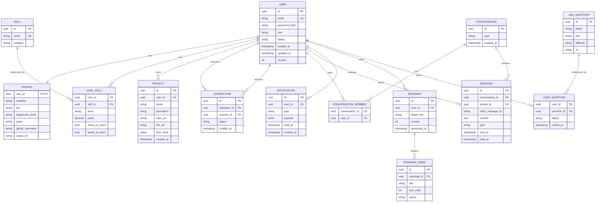

# Data Model

Additional tables (not shown): `profile_embedding(user_id, embedding vector, model, updated_at)`, `roadmap_node_prerequisite(node_id, prerequisite_id)`, `refresh_token(id, user_id, token_hash, expires_at, revoked_at)`, `outbox_event(id, aggregate, type, payload, created_at, published_at)`.

## Database rules

| Rule | Detail |
|---|---|
| IDs | UUIDs for externally visible identifiers |
| Uniqueness | `user.email`, `skill.name`, `(requester_id, receiver_id)` connection pair, `(conversation_id, client_message_id)` |
| Indexes | All foreign keys; discovery filters (skill, level, wants_to_teach/learn); `message(conversation_id, sent_at)` |
| Transactions | Required for multi-table writes |
| Concurrency | Optimistic locking (`version`) where concurrent updates are possible |
| Pagination | Required on every list query |
| Secrets | No raw passwords; refresh tokens stored hashed |
| Migrations | Flyway or Liquibase only; no manual production schema edits |
